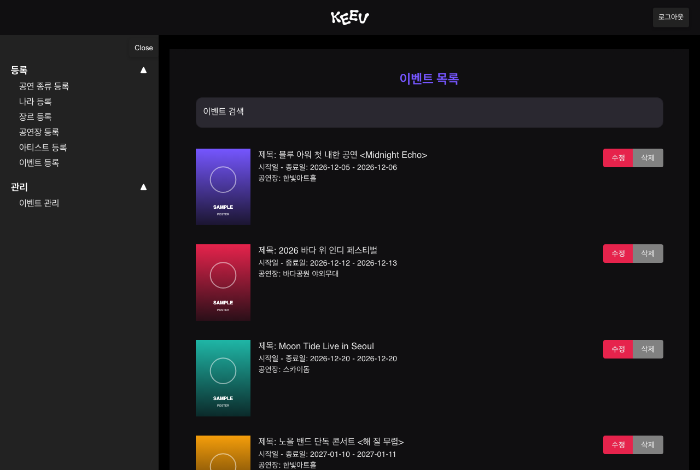
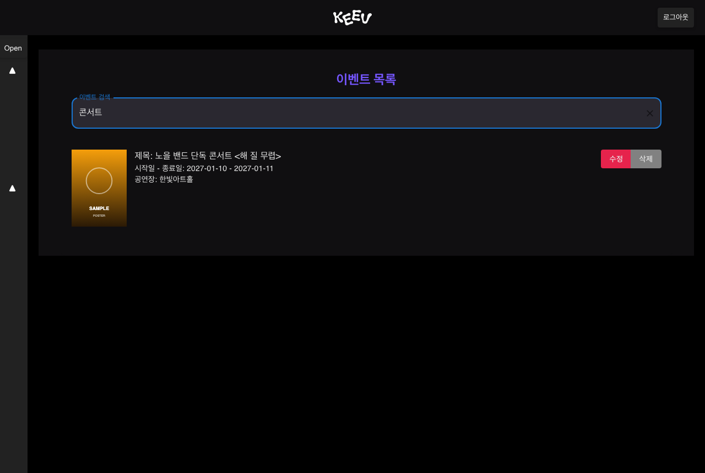
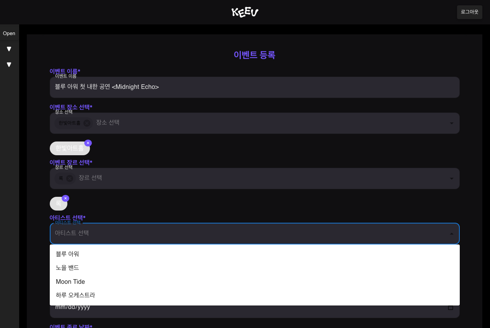
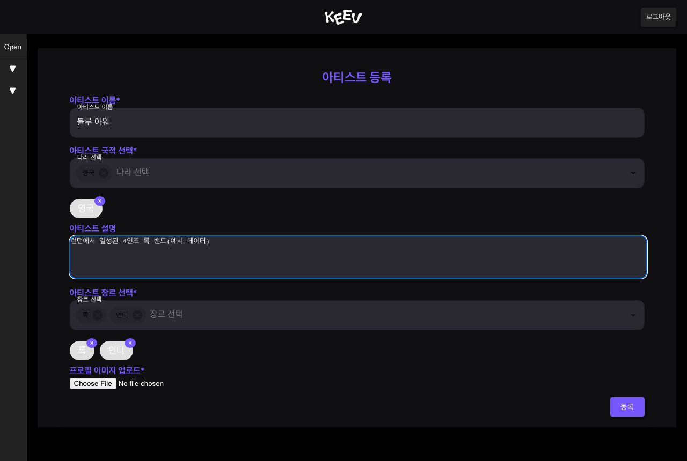

# KEEV Admin

> 공연 커뮤니티 앱 KEEV에 보일 공연 정보를 등록하고 관리하는 관리자 웹

[KEEV](https://github.com/HappyDoran/KEEV_iOS)는 다녀온 공연을 기록하고 같은 공연을 본 사람들과 이야기하는 공연 커뮤니티 iOS 앱입니다.
앱에 보이는 공연은 공연장, 아티스트, 장르, 공연 종류가 서로 이어진 데이터라서, 운영자가 서버에 직접 넣기에는 번거롭고 실수하기 쉽습니다.
KEEV Admin은 이 데이터를 화면의 입력 폼으로 차례대로 등록하고, 등록한 공연을 검색해 고치거나 지울 수 있는 KEEV의 관리자 웹입니다.

## :fireworks: Screenshots

  
  

왼쪽: 등록·관리 메뉴와 이벤트 목록 · 오른쪽: 이벤트 이름 검색

  
  

왼쪽: 이벤트 등록 폼 · 오른쪽: 아티스트 등록 폼

로컬에서 실행한 실제 화면입니다. 서버 응답은 예시용 가상 데이터로 대신했고, 공연·아티스트·공연장과 포스터는 모두 실제와 무관합니다.

## :pushpin: 주요 기능

- **관리자 코드 로그인**: 관리자 확인 코드를 입력해야 관리 화면에 들어갈 수 있습니다.
- **기본 정보 등록**: 콘서트·페스티벌 같은 공연 종류, 공연이 열리는 나라, 팝·록 같은 장르를 이름만 입력해 추가합니다.
- **공연장 등록**: 공연장 이름, 주소, 나라와 함께 위도·경도를 입력합니다. 화면 속 카카오 지도에서 장소를 검색하고 지도를 눌러 좌표를 확인할 수 있습니다.
- **아티스트 등록**: 아티스트 이름, 국적, 장르, 소개 글, 프로필 사진을 등록합니다.
- **공연 등록**: 앞에서 등록한 공연장·장르·아티스트·공연 종류를 목록에서 골라 이어 주고, 공연 기간과 시작 시간, 예매 시작일, 설명, 포스터와 상세 이미지를 함께 올립니다.
- **공연 관리**: 등록한 공연을 포스터, 일정, 공연장과 함께 목록으로 보고, 스크롤하면 다음 공연을 이어서 불러옵니다. 이름으로 검색해 원하는 공연을 찾고, 기존 내용이 채워진 창에서 수정하거나 삭제합니다.

## :sparkles: 기술 스택

  
  
  
  

  
  
  
  

  
  

## :busts_in_silhouette: 팀

Apple Developer Academy @ POSTECH 3기 팀 프로젝트(팀 HMHZ)입니다.

## :gear: 로컬 실행

`.env`에 `REACT_APP_URL`(API 주소), `REACT_APP_ADMIN_CODE`, `REACT_APP_KAKAO_MAP_JAVASCRIPT_KEY`, `REACT_APP_S3_URL`, `REACT_APP_CLOUDFRONT_URL`을 넣습니다.
`npm install --legacy-peer-deps`로 설치하고 `npm run start`로 실행, `npm run build`로 빌드합니다.
